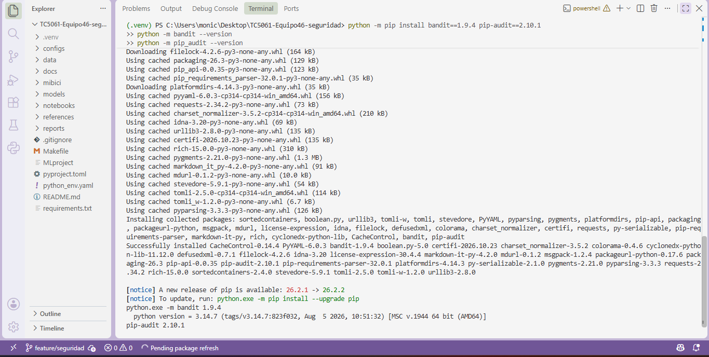
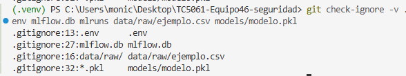
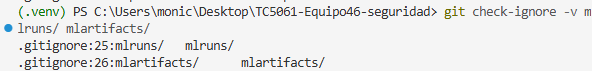
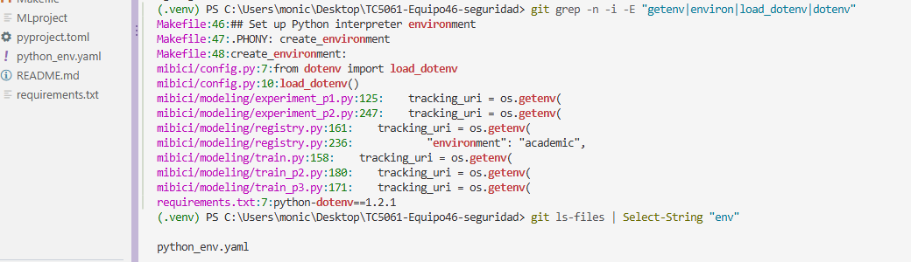
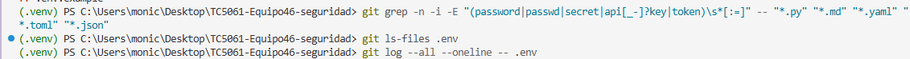
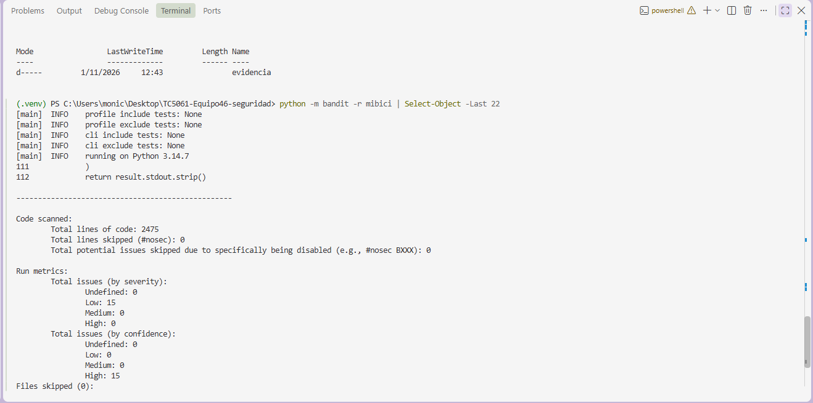
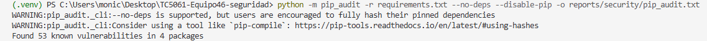

# TC5061-Proyecto-Equipo46 · MiBici

Proyecto de Machine Learning sobre el sistema de bicicleta pública MiBici del Área Metropolitana de Guadalajara.

## Preguntas del proyecto

| # | Pregunta | Tipo de tarea |
|---|---|---|
| P1 | ¿Cuántos viajes se iniciarán en una estación o zona en un periodo futuro? | Regresión |
| P2 | ¿Una estación estará en riesgo de quedarse sin bicicletas o sin anclajes disponibles en un periodo futuro? | Clasificación |
| P3 | ¿Qué grupos de estaciones comparten patrones de uso y dónde se ubican en la ciudad? | Clustering |

## Instalación

Esta guía permite instalar y ejecutar el proyecto en cualquier computadora con Windows, macOS o Linux. No se requiere experiencia previa en programación.

### Requisitos

| Programa | Descarga | Nota |
|---|---|---|
| Python 3.10 o superior | https://www.python.org/downloads/ | En Windows, marcar **"Add Python to PATH"** durante la instalación |
| Git | https://git-scm.com/downloads | Opciones por defecto |
| VS Code (opcional) | https://code.visualstudio.com/ | Cualquier terminal funciona igual |

### Pasos

Abrir una terminal (en VS Code: menú **Terminal → New Terminal**) y ejecutar los siguientes comandos, uno por uno:

**1. Descargar el proyecto**

```bash
git clone https://github.com/axelR07/TC5061-Proyecto-Equipo46.git
cd TC5061-Proyecto-Equipo46
```

**2. Crear y activar un entorno virtual** (aísla las librerías del proyecto)

```bash
python -m venv .venv
```

- Windows: `.venv\Scripts\activate`
- macOS / Linux: `source .venv/bin/activate`

Al activarse, la terminal muestra `(.venv)` al inicio de la línea. En macOS, si `python` no se reconoce, usar `python3`.

**3. Instalar las dependencias**

```bash
pip install -r requirements.txt
pip install -e .
```

Todas las dependencias tienen versión fija en `requirements.txt`, por lo que el entorno es idéntico en cualquier computadora.

## Obtención de los datos (ingesta)

Los datos provienen del portal de datos abiertos de MiBici (https://mibici.net/es/datos-abiertos/): viajes mensuales (`datos_abiertos_AAAA_MM.csv`) y nomenclatura de estaciones (`nomenclatura_2026_09.csv`). Los datos no se incluyen en el repositorio; se descargan con un solo comando.

### Ejecución desde un entorno limpio

Con el entorno virtual activo (ver [Instalación](#instalación)):

```bash
python -m mibici.dataset
```

Este comando procesa el periodo **enero–septiembre 2026** (definido en `mibici/config.py`). Otros comandos disponibles:

| Comando | Uso |
|---|---|
| `python -m mibici.dataset --start 2026-01 --end 2026-03` | Procesar otro periodo |
| `python -m mibici.dataset --verify` | Comprobar que los archivos en disco coinciden con los hashes del manifiesto |

Al terminar correctamente, la terminal muestra una línea `SUCCESS` con la versión de los datos, el número de viajes, de meses y de estaciones.

### Qué hace el comando

1. **Descarga** los archivos en `data/raw/`. Si un archivo ya existe, no se descarga de nuevo. Si el servidor devuelve un error o una página HTML en lugar de un CSV, el mes se registra como faltante.
2. **Lee** cada archivo detectando su codificación (UTF-8 o Latin-1) y su separador.
3. **Unifica los nombres de columnas**, que cambian entre años (por ejemplo, `Viaje_Id` o `Trip_Id` → `trip_id`).
4. **Convierte las fechas con un formato explícito.** Se prueban los formatos `AAAA-MM-DD hh:mm:ss`, `DD/MM/AAAA hh:mm` y `MM/DD/AAAA hh:mm`, y se elige el que ubica más viajes **dentro del mes del archivo**. Así se resuelven fechas ambiguas: en el archivo de mayo, `04/05/2026` solo puede ser el 4 de mayo. Si dos formatos empatan, el mes se marca como no procesado. El formato elegido y el conteo de cada formato quedan registrados en el manifiesto.
5. **Limpia los registros** (ver criterios abajo) y cuenta cuántos se descartan por cada motivo.
6. **Guarda** los datos limpios en formato Parquet en `data/processed/`.
7. **Versiona** los datos en `data/manifest/data_manifest.json` y genera un resumen legible en `reports/ingesta_resumen.md`.

### Columnas

| Columna original | Columna final | Tratamiento |
|---|---|---|
| `Viaje_Id` | `trip_id` | Se conserva |
| `Usuario_Id` | — | **Se elimina** (dato personal, no se usa en P1–P3) |
| `Genero` | `gender` | Se conserva, en mayúsculas |
| `Año_de_nacimiento` | `birth_year` | Se conserva |
| `Inicio_del_viaje` | `start_time` | Se convierte a fecha y hora |
| `Fin_del_viaje` | `end_time` | Se convierte a fecha y hora |
| `Origen_Id` | `origin_id` | Se conserva |
| `Destino_Id` | `destination_id` | Se conserva |
| — | `duration_min` | Nueva: duración del viaje en minutos |

**Estaciones** (`nomenclatura_2026_09.csv`):

| Columna original | Columna final | Tratamiento |
|---|---|---|
| `id` | `station_id` | Se conserva |
| `name` | `name` | Se conserva |
| `latitude` / `longitude` | `lat` / `lon` | Se convierten a número |
| `dpcapacity` | `capacity` | Se convierte a número (anclajes de la estación) |
| — | `active` | Nueva: `False` si el nombre empieza con `ex-` (estación retirada) |
| — | `coords_valid` | Nueva: `False` si las coordenadas están fuera del área metropolitana |

### Criterios de limpieza

**Viajes.** Se descarta un registro si:

| Motivo | Ejemplo |
|---|---|
| Fecha de inicio o fin inválida o vacía | `Inicio_del_viaje = ""` |
| Falta la estación de origen o destino | `Origen_Id = ""` |
| La hora de fin es anterior a la de inicio | inicio `09:00`, fin `08:00` |
| El viaje empieza fuera del mes del archivo | viaje del 31/12/2025 en el archivo de enero 2026 |
| `trip_id` repetido | la misma fila aparece dos veces |

Los viajes cuya estación no aparece en la nomenclatura actual **se conservan** (pueden ser estaciones dadas de baja) y se cuentan en el manifiesto (`trips_with_unknown_station`).

**Estaciones.** El proceso se detiene si faltan las columnas de identificador, latitud o longitud. Se descartan estaciones sin identificador o con identificador duplicado. Las estaciones con coordenadas fuera del Área Metropolitana de Guadalajara (latitud 20.50–20.80, longitud −103.50 a −103.20, definida en `mibici/config.py`) **no se eliminan**: se marcan con `coords_valid = False` y se listan en el manifiesto, porque sus viajes siguen siendo válidos para P1 y P2; solo deben excluirse en análisis que usan la ubicación (P3). Si la capacidad falta o no es válida, se registra una advertencia y la estación se conserva.

### Resultados de la ejecución

# Resumen de la ingesta

- Versión de datos: `d038fe16493d`
- Periodo solicitado: 2026-01 a 2026-09
- Ingesta completa: sí
- Meses faltantes: ninguno
- Estaciones: 484

| Mes | Registros originales | Descartados | Registros finales | Formato de fecha |
|---|---:|---:|---:|---|
| 2026-01 | 357,180 | 0 | 357,180 | `%Y-%m-%d %H:%M:%S` |
| 2026-02 | 333,756 | 0 | 333,756 | `%Y-%m-%d %H:%M:%S` |
| 2026-03 | 376,243 | 0 | 376,243 | `%Y-%m-%d %H:%M:%S` |
| 2026-04 | 351,851 | 0 | 351,851 | `%Y-%m-%d %H:%M:%S` |
| 2026-05 | 315,895 | 0 | 315,895 | `%Y-%m-%d %H:%M:%S` |
| 2026-06 | 355,303 | 0 | 355,303 | `%Y-%m-%d %H:%M:%S` |
| 2026-07 | 388,257 | 0 | 388,257 | `%Y-%m-%d %H:%M:%S` |
| 2026-08 | 393,524 | 0 | 393,524 | `%Y-%m-%d %H:%M:%S` |
| 2026-09 | 490,056 | 758 | 489,298 | `%Y-%m-%d %H:%M:%S` |
| **Total** | 3,362,065 | 758 | 3,361,307 | |

- Archivos originales: separador coma y valores entre comillas. La codificación de caracteres cambia entre archivos (Latin-1 en enero, UTF-8 en septiembre); el proceso la detecta automáticamente y queda registrada en el manifiesto (`encoding`).
- Estaciones: 484 en la nomenclatura, 14 retiradas (`ex-`), 4 con capacidad 0 y ninguna con coordenadas fuera del área metropolitana.
- De enero a agosto no se descartó ningún viaje. En septiembre se descartaron 758 viajes (0.15 % del mes) por tener identificador de viaje repetido; se conserva la primera aparición de cada viaje para no contarlo dos veces.
- Observaciones en el archivo de enero 2026 que **no** se eliminan en la ingesta, porque son decisiones de análisis y se tratan en `features.py`: 10,535 viajes duran menos de 1 minuto (8,899 de ellos regresan a la misma estación); 37 viajes duran más de 3 horas; 2,616 viajes no tienen género y 38 tienen año de nacimiento anterior a 1930.

El resumen de la ingesta completa (enero–septiembre 2026) se genera en `reports/ingesta_resumen.md`.

### Archivos no disponibles

Si un mes no se puede descargar o leer, el proceso continúa con los demás, pero:

- el mes aparece en `missing_months` del manifiesto y `complete` queda en `false`;
- la terminal muestra `INGESTA INCOMPLETA` con la lista de meses faltantes;
- el comando termina con código de error (1), así la ingesta no se da por válida;
- el Parquet de ese mes de una ejecución anterior se elimina, y en `data/processed/` solo quedan los archivos de la ejecución actual, así nunca se mezclan datos de ejecuciones distintas.

### Versionado de los datos

El manifiesto `data/manifest/data_manifest.json` registra los meses solicitados, procesados y faltantes; el número de registros por archivo; los registros descartados por motivo; y el hash SHA-256 de cada archivo original y de cada Parquet generado.

El identificador `data_version` se calcula **solo** a partir del periodo y de los hashes de los CSV originales. Por eso dos ejecuciones con los mismos archivos de entrada producen la misma versión, y cualquier cambio en los datos de MiBici produce una versión distinta. `--verify` comprueba que los archivos en disco no han cambiado. Este identificador se registra en cada experimento de MLflow.

### Estructura de los datos generados

```
data/
├── raw/            # CSV originales de MiBici (no se suben a Git)
├── processed/      # Parquet limpios: trips_AAAA_MM.parquet, stations.parquet (no se suben a Git)
└── manifest/
    └── data_manifest.json   # versión de los datos (sí se sube a Git)
reports/
└── ingesta_resumen.md       # resumen de la última ingesta (sí se sube a Git)
```

### Configuración

Las rutas, el rango de fechas, la semilla aleatoria (`RANDOM_SEED = 42`) y las URLs de MiBici se encuentran únicamente en `mibici/config.py`.

### Solución de problemas

| Problema | Solución |
|---|---|
| `python` no se reconoce | Reinstalar Python marcando "Add Python to PATH", o usar `python3` |
| Windows bloquea la activación del entorno | Ejecutar `Set-ExecutionPolicy -Scope CurrentUser RemoteSigned` y repetir la activación |
| `INGESTA INCOMPLETA` | Revisar en el portal si el mes ya fue publicado; si MiBici cambió la ubicación de los archivos, actualizar `MIBICI_FILES_BASE` en `mibici/config.py` |

### Archivos excluidos de Git

El `.gitignore` excluye los datos de MiBici (`data/raw/`, `data/processed/`, `*.csv`, `*.parquet`), las carpetas de MLflow (`mlruns/`, `mlartifacts/`), el archivo `.env` y los modelos serializados (`models/*`, `*.pkl`, `*.joblib`).

## Estructura del repositorio

```
├── data/              # datos (solo el manifiesto se versiona)
├── models/            # modelos entrenados (no se versionan)
├── notebooks/         # notebooks de exploración
├── references/        # ML Canvas y diagrama de arquitectura
├── reports/           # resumen de ingesta y figuras
├── mibici/            # código del proyecto
│   ├── config.py      # rutas, fechas, semilla y URLs
│   ├── dataset.py     # ingesta y versionado de datos
│   ├── features.py    # feature engineering
│   └── modeling/
│       ├── project_train.py
│       ├── train.py
│       ├── train_p2.py
│       └── train_p3.py
├── MLproject
├── python_env.yaml
├── pyproject.toml
└── requirements.txt
```

## Experimento base (MLflow)

El seguimiento local de MLflow utiliza una base SQLite para guardar experimentos y runs.

### Iniciar el servidor

Desde la raíz del repositorio, en una terminal de PowerShell con `.venv` activo, ejecuta:

```powershell
.\.venv\Scripts\mlflow.exe server --backend-store-uri sqlite:///mlflow.db --host 127.0.0.1 --port 5000 --workers 1
```

Mantén esta terminal abierta mientras uses MLflow. El servidor estará disponible en <http://127.0.0.1:5000>. Para detenerlo, presiona `Ctrl+C`.

### Conectar los comandos del proyecto

En una segunda terminal de PowerShell, con `.venv` activo, configura la URI y el experimento:

```powershell
$env:MLFLOW_TRACKING_URI = "http://127.0.0.1:5000"
$env:MLFLOW_EXPERIMENT_NAME = "mibici-equipo46"
```

Estas variables hacen que los procesos de esa terminal registren sus runs en el servidor y experimento correctos.

### Reproducir ingesta y entrenamientos con MLflow Projects

Desde la raíz del repositorio y con el servidor activo, ejecuta:

```powershell
mlflow run . --entry-point ingest --env-manager local
mlflow run . --entry-point train --env-manager local -P question=P1
mlflow run . --entry-point train --env-manager local -P question=P2
mlflow run . --entry-point train --env-manager local -P question=P3
```

Los modelos y sus hiperparámetros predeterminados se obtienen de `mibici/config.py`:

| Pregunta | Modelo | Hiperparámetros predeterminados |
|---|---|---|
| P1 | `dummy_regressor` | `strategy=mean` |
| P2 | `dummy_classifier` | `strategy=most_frequent`, `risk_fraction=0.10` |
| P3 | `kmeans` | `n_clusters=3`, `n_init=10`, `max_iter=300` |

El comando `ingest` descarga y procesa los datos. Después, cada comando `train` utiliza los archivos procesados y el manifiesto de esa ingesta. Los comandos se ejecutan mediante el MLflow Project, no desde un notebook.

### Archivos locales

La base `mlflow.db` y los artefactos se guardan localmente y están excluidos de Git mediante `.gitignore`.

## Flujo de trabajo con Git

Convención de ramas y de commits, protección de la rama principal y proceso de Pull Request y revisión.

## Integrantes

- Ivan Plata Garnica
- Axel Fernando Rabago Diaz
- Monica Maria Ramirez Mejia

## Experimentación avanzada y Model Registry — Semana 6

### Objetivo

Esta etapa amplía el proyecto MiBici del Equipo 46 mediante experimentación avanzada, búsqueda de hiperparámetros, seguimiento de ejecuciones con MLflow y gestión de los modelos seleccionados mediante Model Registry.

Los experimentos utilizan la versión de datos `d038fe16493d` y conservan las particiones temporales y criterios de evaluación de los baselines.

### Requisitos

- Python y dependencias especificadas en `requirements.txt`.
- MLflow Tracking Server con backend SQLite.
- Datos de MiBici generados mediante el proceso de ingesta.
- Archivos `MLproject` y `python_env.yaml`.
- Entorno de ejecución configurado con las dependencias del proyecto.

### 1. Configurar MLflow

Desde la raíz del repositorio, iniciar el servidor:

```powershell
mlflow server --backend-store-uri sqlite:///mlflow.db --host 127.0.0.1 --port 5000
```

En una segunda terminal configurar:

```powershell
$env:MLFLOW_TRACKING_URI = "http://127.0.0.1:5000"
```

El servidor estará disponible en `http://127.0.0.1:5000`.

### 2. Ejecutar la ingesta

```powershell
mlflow run . -e ingest --env-manager local --experiment-name mibici-equipo46
```

Verificar los archivos contra el manifiesto:

```powershell
python -m mibici.dataset --verify
```

### 3. Ejecutar los baselines

P1 — Predicción de demanda:

```powershell
mlflow run . -e train -P question=P1 -P model=dummy_regressor -P hyperparameters="{}" --env-manager local --experiment-name mibici-equipo46
```

P2 — Presión operacional:

```powershell
mlflow run . -e train -P question=P2 -P model=dummy_classifier -P hyperparameters="{}" --env-manager local --experiment-name mibici-equipo46
```

P3 — Agrupación de estaciones:

```powershell
mlflow run . -e train -P question=P3 -P model=kmeans -P hyperparameters="{}" --env-manager local --experiment-name mibici-equipo46
```

### 4. Ejecutar la experimentación avanzada

P1 — Tres candidatos de HistGradientBoostingRegressor:

```powershell
mlflow run . -e search_p1 --env-manager local --experiment-name mibici-equipo46
```

P2 — Tres candidatos de HistGradientBoostingClassifier:

```powershell
mlflow run . -e search_p2 --env-manager local --experiment-name mibici-equipo46
```

P3 — Búsqueda de KMeans con K=4, 5 y 6:

```powershell
mlflow run . -e search_p3 --env-manager local --experiment-name mibici-equipo46
```

Para reproducir el modelo P3 seleccionado, K=3:

```powershell
mlflow run . -e train -P question=P3 -P model=kmeans -P hyperparameters=@configs/p3_k3.json --env-manager local --experiment-name mibici-equipo46
```

Las búsquedas registran parámetros, métricas, artefactos y modelos asociados a sus ejecuciones.

### 5. Resultados experimentales

| Pregunta | Baseline | Modelo seleccionado | Principal resultado |
|---|---|---|---|
| P1 | DummyRegressor | P1-HGB-02 | MAE validación: 1.3104 → 0.7352 |
| P2 | DummyClassifier | P2-HGB-03 | F1 validación: 0 → 0.4855 |
| P3 | KMeans K=3 | KMeans K=3 | Silhouette: 0.4506; mejor entre K=3, 4, 5 y 6 |

P1 utiliza MAE de validación como criterio de selección.

P2 utiliza F1 de validación, con Recall y Balanced Accuracy como criterios secundarios.

P3 compara Silhouette, Calinski-Harabasz, Inertia y la distribución de las estaciones.

### 6. Registrar modelos seleccionados

Ejecutar:

```powershell
python -m mibici.modeling.registry
```

El script identifica automáticamente los modelos candidatos registrados en MLflow, comprueba la versión de los datos y registra las versiones seleccionadas.

Los modelos registrados son:

| Pregunta | Modelo registrado | Alias |
|---|---|---|
| P1 | `mibici-equipo46-p1-demanda` | `champion` |
| P2 | `mibici-equipo46-p2-riesgo` | `champion` |
| P3 | `mibici-equipo46-p3-grupos` | `champion` |

Los modelos se pueden recuperar mediante:

```text
models:/mibici-equipo46-p1-demanda@champion
models:/mibici-equipo46-p2-riesgo@champion
models:/mibici-equipo46-p3-grupos@champion
```

El alias `champion` identifica los modelos seleccionados para la entrega académica. No implica que exista un servicio de producción desplegado.

**Por qué se usan aliases.** El Model Registry puede marcar la versión "oficial" de un modelo de dos formas: con etapas (`Staging`, `Production`) o con aliases. Este proyecto usa aliases (`champion`), porque las etapas están deprecadas desde MLflow 2.9 y los aliases son el esquema vigente.

Un alias es una etiqueta con nombre que apunta a una versión concreta del modelo. Cuando se entrena una versión mejor, se mueve el alias `champion` a la nueva versión y el código que consume el modelo no cambia, porque siempre lo carga con `models:/<nombre>@champion`. Además, una misma versión puede tener varios aliases (por ejemplo, `champion` y `challenger`), algo que las etapas no permiten.

### 7. Artefactos

Los experimentos registran, según la pregunta:

- Modelos con firma y ejemplo de entrada.
- Configuraciones de entrenamiento.
- Manifiesto y versión de datos.
- Gráficas de evaluación.
- Matrices de confusión.
- Resultados comparativos.
- Metadatos para trazabilidad.

### 8. Reproducibilidad y limitaciones

Los archivos CSV y Parquet, modelos serializados, bases SQLite, entornos virtuales y artefactos locales de MLflow no se incorporan al repositorio Git.

Las ejecuciones deben realizarse utilizando el entorno configurado y los mismos datos para obtener resultados comparables.

En P2, el objetivo corresponde a un indicador indirecto de presión operacional calculado a partir del flujo neto y la capacidad de las estaciones; no representa directamente la disponibilidad real de bicicletas.

En P3, las predicciones requieren generar previamente los perfiles de estaciones con el mismo orden de características utilizado durante el entrenamiento.

La experimentación y el Model Registry forman parte de un entorno académico local, por lo que no constituyen un despliegue productivo de los modelos.

## Chequeos de seguridad (Semana 7)

Esta sección documenta las prácticas y herramientas de seguridad aplicadas al repositorio: protección de credenciales y datos sensibles, análisis de código con **bandit** y análisis de dependencias con **pip-audit**. La evidencia de cada ejecución está en `docs/evidencia/` y los reportes completos en `reports/security/`.

### Instalación de las herramientas

```powershell
python -m pip install bandit==1.9.4 pip-audit==2.10.1
python -m bandit --version
python -m pip_audit --version
```



### 1. Credenciales y datos sensibles

**`.gitignore`.** Excluye los archivos que no deben versionarse. Se verificó con `git check-ignore -v`:

```powershell
git check-ignore -v .env mlflow.db mlruns data/raw/ejemplo.csv models/modelo.pkl
git check-ignore -v mlruns/ mlartifacts/
```

| Elemento | Regla de `.gitignore` |
|---|---|
| `.env` (variables locales) | línea 13 |
| `data/raw/` (datos) | línea 16 |
| `mlruns/` (experimentos de MLflow) | línea 25 |
| `mlartifacts/` (artefactos de MLflow) | línea 26 |
| `mlflow.db` (base de MLflow) | línea 27 |
| `*.pkl` (modelos serializados) | línea 32 |




**Variables de entorno.** El código no escribe configuración sensible: `mibici/config.py` carga un archivo `.env` local con `load_dotenv()` y los scripts de `mibici/modeling/` leen la dirección del servidor de MLflow con `os.getenv("MLFLOW_TRACKING_URI", ...)`. Es la única variable de entorno que usa el proyecto. Para documentarla se agregó `.env.example`, una plantilla sin valores secretos. Cada integrante crea su propio `.env` a partir de ella; ese archivo está en `.gitignore` y no se sube.

```powershell
git grep -n -i -E "getenv|environ|load_dotenv|dotenv"
git ls-files | Select-String "env"
```



**Búsqueda de credenciales.** No hay contraseñas ni claves escritas en el código, no hay un archivo `.env` en el repositorio y nunca se subió uno en el historial: los tres comandos devuelven resultados vacíos.

```powershell
git grep -n -i -E "(password|passwd|secret|api[_-]?key|token)\s*[:=]" -- "*.py" "*.md" "*.yaml" "*.toml" "*.json"
git ls-files .env
git log --all --oneline -- .env
```



### 2. Análisis de código con bandit

```powershell
python -m bandit -r mibici
python -m bandit -r mibici -f txt -o reports/security/bandit.txt
```

Se revisaron 2475 líneas de código de `mibici/`. Resultado: **15 hallazgos, todos de severidad baja** (0 medios y 0 altos), de tres tipos y cinco de cada uno:

| Código | Descripción | Cantidad |
|---|---|---|
| B404 | Se importa el módulo `subprocess` | 5 |
| B603 | `subprocess` llamado sin `shell=True` (revisar que no reciba entradas no confiables) | 5 |
| B607 | Se ejecuta un programa por su nombre (`git`), no por ruta completa | 5 |

Están en cinco archivos de `mibici/modeling/`: `experiment_p1.py`, `experiment_p2.py`, `train.py`, `train_p2.py` y `train_p3.py`. En todos corresponden a la misma llamada, `subprocess.run` o `subprocess.check_output` con `["git", "rev-parse", "HEAD"]`, que obtiene el identificador del commit actual. Los argumentos son fijos, no se usa `shell=True` y no interviene ninguna entrada del usuario; en `experiment_p1.py` y `experiment_p2.py`, si la llamada falla, se devuelve `"unknown"`. Por eso se aceptan como riesgo bajo. El reporte completo está en `reports/security/bandit.txt`.



### 3. Dependencias con pip-audit

```powershell
python -m pip_audit -r requirements.txt --no-deps --disable-pip -o reports/security/pip_audit.txt
```

Resultado (1 de noviembre de 2026): **53 vulnerabilidades conocidas en 4 paquetes** de `requirements.txt`:

| Paquete | Versión fijada | Vulnerabilidades |
|---|---|---|
| `pyarrow` | 22.0.0 | 2 |
| `requests` | 2.32.5 | 2 |
| `python-dotenv` | 1.2.1 | 2 |
| `mlflow` | 3.6.0 | 47 |

El detalle de cada una, con la versión que la corrige, está en `reports/security/pip_audit.txt`. La revisión se hizo con `--no-deps`, es decir, solo sobre los paquetes listados en `requirements.txt`, sin sus dependencias indirectas.

Riesgo conocido: las versiones fijadas en el proyecto tienen vulnerabilidades reportadas, sobre todo en `mlflow`. Actualizarlas puede cambiar los resultados de los experimentos, por lo que debe hacerse validando de nuevo el entrenamiento y el registro de modelos antes de modificar `requirements.txt`.



### Uso de IA

Se usó Claude (Anthropic, 2026) como apoyo para estructurar y redactar esta sección. Los comandos y las capturas son de mi propia ejecución.
