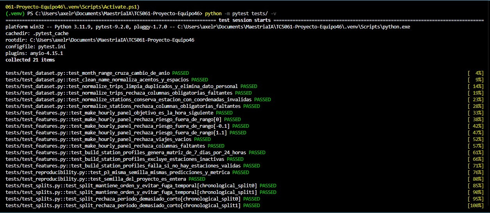
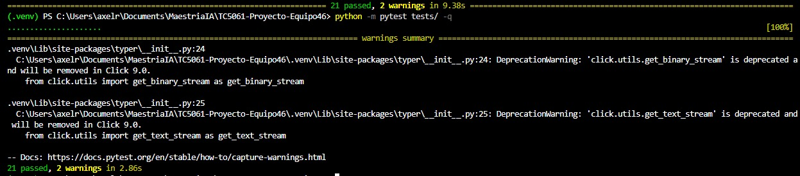
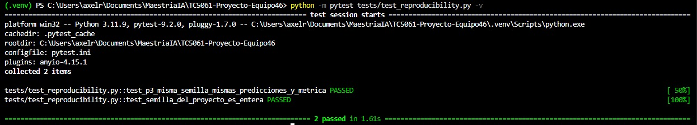

# Semana 7 — Testing, validación y seguridad en MLOps

**Proyecto:** MiBici — Equipo 46  
**Materia:** Operaciones de Aprendizaje Automático  
**Institución:** Tecnológico de Monterrey  
**Actividad:** Tests + Chequeos de seguridad básicos integrados al repositorio  
**Modalidad:** Colaborativa  

---

## Objetivo

Durante la Semana 7 se incorporan pruebas automatizadas y mecanismos de validación al proyecto MiBici del Equipo 46, con el propósito de fortalecer la calidad, confiabilidad, reproducibilidad y seguridad del código desarrollado.

A diferencia de las semanas anteriores, enfocadas principalmente en el entrenamiento, evaluación y registro de modelos mediante MLflow, esta etapa busca comprobar que las funciones del proyecto produzcan resultados correctos, que se puedan identificar comportamientos inesperados y que los experimentos puedan reproducirse bajo condiciones controladas.

Las actividades se organizaron en tres componentes principales:

1. **Pruebas unitarias y reproducibilidad mediante PyTest:** validar funciones clave del proyecto, incluyendo casos normales, casos límite y consistencia del entrenamiento.
2. **Validación de calidad de datos mediante DeepChecks:** identificar posibles inconsistencias, valores faltantes, duplicados y cambios en las distribuciones de los datos.
3. **Revisión de seguridad del repositorio:** verificar la protección de credenciales, el manejo adecuado de información sensible y posibles vulnerabilidades del código o sus dependencias.

Adicionalmente, se estableció una estructura organizada de pruebas que permite ejecutarlas desde la raíz del repositorio mediante un solo comando.

---

## 1. Pruebas unitarias con PyTest

**Responsable:** Axel Fernando Rábago Díaz.

### 1.1. Propósito

Se implementaron pruebas automatizadas utilizando PyTest, con el objetivo de validar funciones clave del proyecto relacionadas con la preparación de datos, la ingeniería de características, las particiones temporales y la reproducibilidad.

Las pruebas incluyen escenarios normales, casos límite y condiciones inválidas, permitiendo identificar errores antes de que puedan afectar los resultados del entrenamiento.

Esta implementación busca fortalecer la confiabilidad del código y facilitar que futuras modificaciones puedan verificarse sin necesidad de ejecutar nuevamente todos los procesos del proyecto.

### 1.2. Organización de las pruebas

Se incorporó la carpeta `tests/` y el archivo `pytest.ini` en la raíz del repositorio.

La estructura es la siguiente:

```text
TC5061-Proyecto-Equipo46/
├── data/
├── docs/
│   ├── README_Semana7.md
│   └── evidencias_semana7/
│       ├── 01_pytest_21_pruebas.jpeg
│       ├── 02_pytest_resumen.jpeg
│       └── 03_pytest_reproducibilidad.jpeg
├── mibici/
├── models/
├── notebooks/
├── references/
├── reports/
├── tests/
│   ├── test_dataset.py
│   ├── test_features.py
│   ├── test_reproducibility.py
│   └── test_splits.py
├── .gitignore
├── MLproject
├── pyproject.toml
├── pytest.ini
├── README.md
└── requirements.txt
```

Cada archivo contiene pruebas específicas para evaluar diferentes componentes del proyecto.

Esta organización permite mantener separadas las pruebas del código principal y facilita su mantenimiento conforme se incorporen nuevas funcionalidades.

### 1.3. Pruebas implementadas

Se desarrollaron y ejecutaron 21 casos de prueba, distribuidos de la siguiente manera:

| Archivo | Pruebas | Descripción |
|---|---:|---|
| `test_dataset.py` | 6 | Validación de fechas, nombres, viajes y estaciones. |
| `test_features.py` | 9 | Validación de características para demanda, riesgo y perfiles de estaciones. |
| `test_reproducibility.py` | 2 | Reproducibilidad controlada de KMeans y verificación de la semilla. |
| `test_splits.py` | 4 | Validación de particiones temporales y prevención de fuga de información. |
| **Total** | **21** | **Todas las pruebas se ejecutaron satisfactoriamente.** |

### 1.4. Principales escenarios evaluados

#### Preparación y limpieza de datos

Se verificaron las funciones relacionadas con el procesamiento inicial de la información de MiBici, considerando:

- Generación correcta de rangos de meses, incluyendo cambios de año.
- Normalización de nombres, acentos y espacios.
- Eliminación de registros duplicados.
- Exclusión de información personal innecesaria.
- Identificación de columnas obligatorias faltantes.
- Tratamiento de estaciones que presentan coordenadas inválidas.

Estas pruebas permiten verificar que las funciones de preparación de datos respondan adecuadamente ante diferentes condiciones.

#### Ingeniería de características

Se evaluaron funciones que permiten construir las variables utilizadas por los modelos del proyecto.

Los escenarios incluyen:

- Comprobación de que el objetivo de predicción corresponda a la hora siguiente.
- Validación de parámetros de riesgo dentro de los rangos permitidos.
- Manejo de conjuntos de viajes vacíos.
- Identificación de columnas faltantes.
- Construcción de perfiles de estaciones considerando siete días de la semana y 24 horas.
- Exclusión de estaciones inactivas.
- Identificación de situaciones en las que no existen estaciones válidas para el análisis.

Estas verificaciones son importantes porque un error en la generación de características puede afectar directamente el entrenamiento y las predicciones.

#### Particiones temporales

Se incorporaron pruebas para verificar que los conjuntos de entrenamiento, validación y prueba respeten el orden cronológico.

Los principales aspectos evaluados fueron:

- Conservación del orden temporal.
- Separación adecuada de periodos.
- Prevención de fuga de información temporal (*data leakage*).
- Validación del comportamiento cuando el periodo disponible es insuficiente.

Estas pruebas ayudan a evitar que el modelo utilice información futura durante su entrenamiento, lo que podría generar evaluaciones artificialmente favorables.

### 1.5. Preparación del entorno

Para reproducir las pruebas se recomienda utilizar Python 3.11 y un entorno virtual con las dependencias del proyecto instaladas.

Desde la raíz del repositorio, crear el entorno virtual en Windows:

```powershell
py -3.11 -m venv .venv
```

Activarlo:

```powershell
.\.venv\Scripts\Activate.ps1
```

Instalar las dependencias:

```powershell
python -m pip install --upgrade pip
python -m pip install -r requirements.txt
python -m pip install -e .
python -m pip install pytest
```

Para verificar PyTest:

```powershell
python -m pytest --version
```

La ejecución documentada se realizó utilizando el siguiente entorno:

| Componente | Configuración |
|---|---|
| Sistema operativo | Windows |
| Python | 3.11.9 |
| PyTest | 9.2.0 |
| Entorno de desarrollo | Visual Studio Code |
| Entorno virtual | `.venv` |
| Repositorio | TC5061-Proyecto-Equipo46 |

### 1.6. Ejecución de las pruebas

Con el entorno virtual activado, ejecutar el siguiente comando desde la raíz del repositorio:

```powershell
python -m pytest tests/ -v
```

El comando permite ejecutar las pruebas ubicadas dentro de la carpeta `tests/` de forma automatizada.

También es posible obtener un resumen más compacto:

```powershell
python -m pytest tests/ -q
```

Estas pruebas utilizan conjuntos de datos de prueba pequeños y controlados, por lo que no requieren iniciar el servidor de MLflow ni realizar nuevamente la ingesta completa de los datos históricos de MiBici.

### 1.7. Resultados obtenidos

La ejecución de las pruebas se realizó satisfactoriamente.

| Indicador | Resultado |
|---|---:|
| Pruebas recolectadas | 21 |
| Pruebas aprobadas | 21 |
| Pruebas fallidas | 0 |
| Errores de ejecución | 0 |
| Advertencias | 2 |
| Tiempo de ejecución | 9.38 segundos |
| Porcentaje de pruebas aprobadas | 100% |

El resultado final obtenido en la terminal fue:

```text
21 passed, 2 warnings in 9.38s
```

Las dos advertencias corresponden a funciones de la dependencia `click` utilizadas por `typer`, identificadas como obsoletas para versiones futuras.

Estas advertencias no provocaron fallas en las pruebas ejecutadas.

El porcentaje de aprobación del 100% corresponde exclusivamente a los 21 casos ejecutados y no debe confundirse con un porcentaje de cobertura total del código del proyecto.

### 1.8. Evidencias de las pruebas unitarias

**Evidencia 1. Ejecución de las 21 pruebas con PyTest**

La siguiente captura muestra los casos ejecutados, sus nombres y los resultados satisfactorios.



**Evidencia 2. Resumen de resultados de PyTest**

La siguiente evidencia presenta el resumen de la ejecución automatizada, confirmando que las 21 pruebas finalizaron satisfactoriamente.



---

## 2. Prueba de reproducibilidad del entrenamiento

**Responsable:** Axel Fernando Rábago Díaz.

### 2.1. Objetivo

La reproducibilidad es un elemento fundamental de MLOps, ya que permite comprobar que un experimento puede repetirse bajo condiciones controladas y producir resultados consistentes.

Para esta actividad se incorporó una prueba relacionada con el algoritmo de clustering KMeans, utilizado en la pregunta P3 del proyecto MiBici, cuyo propósito es identificar grupos de estaciones que comparten patrones de uso similares.

### 2.2. Procedimiento

Se realizaron dos entrenamientos controlados utilizando:

- El mismo conjunto de datos sintéticos.
- La misma configuración del algoritmo KMeans.
- La misma semilla aleatoria.
- Los mismos parámetros de entrenamiento.
- Las mismas condiciones de comparación.

Posteriormente, se compararon las predicciones obtenidas y la métrica correspondiente para identificar posibles diferencias entre ambas ejecuciones.

Adicionalmente, se verificó que la semilla configurada en el proyecto correspondiera a un valor entero.

Es importante considerar que establecer una semilla fija ayuda a controlar la aleatoriedad, pero la reproducibilidad también depende de otros elementos, como los datos utilizados, las versiones de las bibliotecas y las condiciones de ejecución.

### 2.3. Ejecución de la prueba

Para ejecutar únicamente las pruebas de reproducibilidad:

```powershell
python -m pytest tests/test_reproducibility.py -v
```

### 2.4. Resultados obtenidos

Se ejecutaron las siguientes pruebas:

| Prueba | Resultado |
|---|---|
| `test_p3_misma_semilla_mismas_predicciones_y_metrica` | PASSED |
| `test_semilla_del_proyecto_es_entera` | PASSED |

El resultado registrado fue:

```text
2 passed in 1.61s
```

Los resultados permiten comprobar la consistencia del entrenamiento controlado de KMeans bajo las condiciones establecidas.

Es importante señalar que esta validación utiliza datos sintéticos y no representa una reproducción completa del pipeline de entrenamiento de MiBici ni de los experimentos registrados en MLflow.

Por lo tanto, se considera una prueba automatizada de reproducibilidad de un componente del entrenamiento.

### 2.5. Evidencia de reproducibilidad

**Evidencia 3. Ejecución de las pruebas de reproducibilidad de KMeans P3**

La siguiente captura muestra la ejecución individual de las dos pruebas de reproducibilidad, ambas con resultados satisfactorios.



---

## 3. Validación de datos con DeepChecks

**Responsable:** Integrante encargado del punto 2.

**Estado:** Pendiente de integrar resultados y evidencias.

### 3.1. Objetivo

Implementar verificaciones automatizadas de calidad de datos mediante DeepChecks, con el propósito de identificar inconsistencias en los conjuntos utilizados durante el desarrollo de los modelos de Machine Learning.

Las validaciones deberán considerar, según las características del dataset:

- Valores faltantes.
- Registros duplicados.
- Tipos de datos inconsistentes.
- Posibles anomalías.
- Diferencias relevantes entre los conjuntos de entrenamiento y prueba.
- Posibles cambios en las distribuciones de los datos (*data drift*).

### 3.2. Implementación

Pendiente de documentar las funciones y verificaciones incorporadas, así como los archivos utilizados para ejecutar los chequeos de DeepChecks.

Se deberán registrar los comandos necesarios para reproducir las validaciones desde la raíz del proyecto.

### 3.3. Resultados de validación

Pendiente de documentar los chequeos ejecutados, sus resultados y los hallazgos identificados.

En caso de detectar inconsistencias, deberán explicarse las observaciones y sus posibles implicaciones sobre la calidad del dataset.

### 3.4. Evidencias

Pendiente de incorporar las capturas correspondientes a la ejecución de DeepChecks.

---

## 4. Revisión de seguridad del repositorio

**Responsable:** Integrante encargado del punto 3.

**Estado:** Pendiente de integrar resultados y evidencias.

### 4.1. Objetivo

Verificar que el proyecto cumpla con buenas prácticas básicas de seguridad, especialmente en el manejo de información sensible y la identificación de posibles vulnerabilidades del código y sus dependencias.

### 4.2. Aspectos por revisar

Se deberán considerar los siguientes elementos:

- Ausencia de contraseñas y tokens expuestos en el código fuente.
- Manejo de credenciales mediante variables de entorno.
- Configuración adecuada del archivo `.gitignore`.
- Exclusión de entornos virtuales y archivos locales sensibles.
- Identificación de posibles vulnerabilidades en código o dependencias.
- Documentación de los resultados obtenidos.

### 4.3. Herramientas de análisis

Para el análisis de seguridad se podrá utilizar Bandit o pip-audit, conforme a los requisitos de la actividad.

**Análisis estático con Bandit**

Instalación:

```powershell
python -m pip install bandit
```

Ejecución:

```powershell
python -m bandit -r mibici
```

**Auditoría de dependencias con pip-audit**

Instalación:

```powershell
python -m pip install pip-audit
```

Ejecución:

```powershell
python -m pip_audit -r requirements.txt
```

Estos comandos se presentan como referencias de ejecución y no constituyen evidencia de que los análisis ya se hayan realizado.

### 4.4. Resultados de seguridad

Pendiente de incorporar los resultados de la herramienta utilizada.

Deberán documentarse las vulnerabilidades o advertencias identificadas, su importancia y las acciones realizadas o propuestas para su atención.

### 4.5. Evidencias

Pendiente de agregar las capturas correspondientes al análisis de seguridad y sus resultados.

---

## 5. Organización y ejecución de las verificaciones

### 5.1. Estructura centralizada de pruebas

Con la finalidad de facilitar la ejecución y mantenimiento de las pruebas, se estableció una estructura centralizada dentro de la carpeta `tests/`.

La configuración de PyTest se encuentra en el archivo `pytest.ini`.

Esta organización permite incorporar nuevas pruebas conforme evolucione el proyecto, manteniendo un procedimiento de ejecución consistente.

### 5.2. Comando general de ejecución

Para ejecutar las pruebas automatizadas ubicadas en la carpeta `tests/`:

```powershell
python -m pytest tests/ -v
```

La ejecución puede realizarse desde cualquier terminal que tenga acceso al proyecto y cuente con las dependencias necesarias.

### 5.3. Ejecución individual de pruebas

También pueden ejecutarse las pruebas de forma independiente:

**Preparación de datos**

```powershell
python -m pytest tests/test_dataset.py -v
```

**Ingeniería de características**

```powershell
python -m pytest tests/test_features.py -v
```

**Reproducibilidad**

```powershell
python -m pytest tests/test_reproducibility.py -v
```

**Particiones temporales**

```powershell
python -m pytest tests/test_splits.py -v
```

Las verificaciones de seguridad mediante herramientas externas deberán documentarse adicionalmente, ya que no forman parte automáticamente de la ejecución de PyTest.

---

## 6. Trabajo colaborativo y control de versiones

El trabajo de la Semana 7 se desarrolla mediante ramas independientes, permitiendo que cada integrante incorpore sus aportaciones sin modificar directamente el trabajo de los demás.

Esta metodología facilita la revisión de cambios, la identificación de responsables y la integración de nuevas funcionalidades mediante Pull Requests.

### 6.1. Contribución de Axel Fernando Rábago Díaz

**Rama de trabajo:**

`feature/semana7-pytest-axel`

**Commit local registrado:**

`35c39a8`

**Descripción del commit:**

```text
test: agrega 21 pruebas unitarias y reproducibilidad MiBici
```

Se incorporaron cinco archivos nuevos y 286 líneas de código, correspondientes a cuatro módulos de pruebas y la configuración de PyTest.

Los cambios fueron validados localmente mediante la ejecución satisfactoria de las 21 pruebas.

La integración definitiva de esta contribución al repositorio central deberá verificarse mediante GitHub y su correspondiente Pull Request.

### 6.2. Contribución de los demás integrantes

Pendiente de incorporar las ramas, commits y Pull Requests correspondientes a:

- Validación de datos con DeepChecks.
- Revisión de seguridad del repositorio.
- Documentación de resultados y evidencias.

### 6.3. Repositorio del proyecto

Repositorio central del Equipo 46:

https://github.com/iplatamx/TC5061-Proyecto-Equipo46

La entrega final deberá realizarse sobre el repositorio que el equipo confirme como versión consolidada del proyecto.

---

## 7. Conclusiones de la Semana 7

Las pruebas automatizadas implementadas permiten fortalecer la confiabilidad del proyecto MiBici, al comprobar el comportamiento de funciones importantes utilizadas durante la preparación y transformación de datos.

La ejecución satisfactoria de 21 pruebas demuestra que los escenarios evaluados producen los resultados esperados bajo las condiciones establecidas. Asimismo, la prueba de reproducibilidad de KMeans aporta evidencia sobre la consistencia de un entrenamiento controlado.

Uno de los aprendizajes más importantes de esta actividad es comprender que desarrollar un modelo de Machine Learning no termina cuando conseguimos buenas métricas de desempeño. También es necesario demostrar que los procesos utilizados para obtener esos resultados son verificables y pueden ejecutarse de manera consistente.

Consideramos que la incorporación de pruebas automatizadas representa un avance importante en la aplicación de MLOps, ya que permite identificar errores de manera anticipada y reducir el riesgo de introducir modificaciones que afecten componentes existentes.

Finalmente, la organización de las pruebas y su documentación facilita que los integrantes del equipo puedan ejecutar nuevamente las verificaciones, revisar los resultados y continuar incorporando controles de calidad conforme evolucione el proyecto.

Los resultados de DeepChecks y seguridad se integrarán a esta documentación una vez que se completen las actividades correspondientes.

---

## 8. Referencias

Bandit. (s. f.). *Bandit documentation*. https://bandit.readthedocs.io/en/latest/

DeepChecks. (s. f.). *DeepChecks documentation*. https://docs.deepchecks.com/

pip-audit. (s. f.). *pip-audit*. Python Package Index. https://pypi.org/project/pip-audit/

pytest development team. (s. f.). *pytest documentation*. https://docs.pytest.org/en/stable/

OWASP Foundation. (s. f.). *Machine learning security top ten*. https://owasp.org/www-project-machine-learning-security-top-10/
