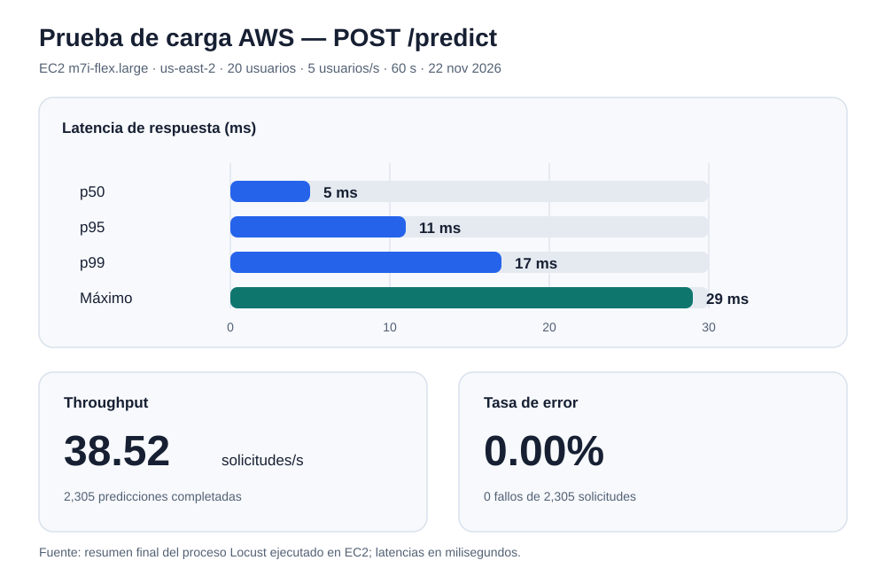
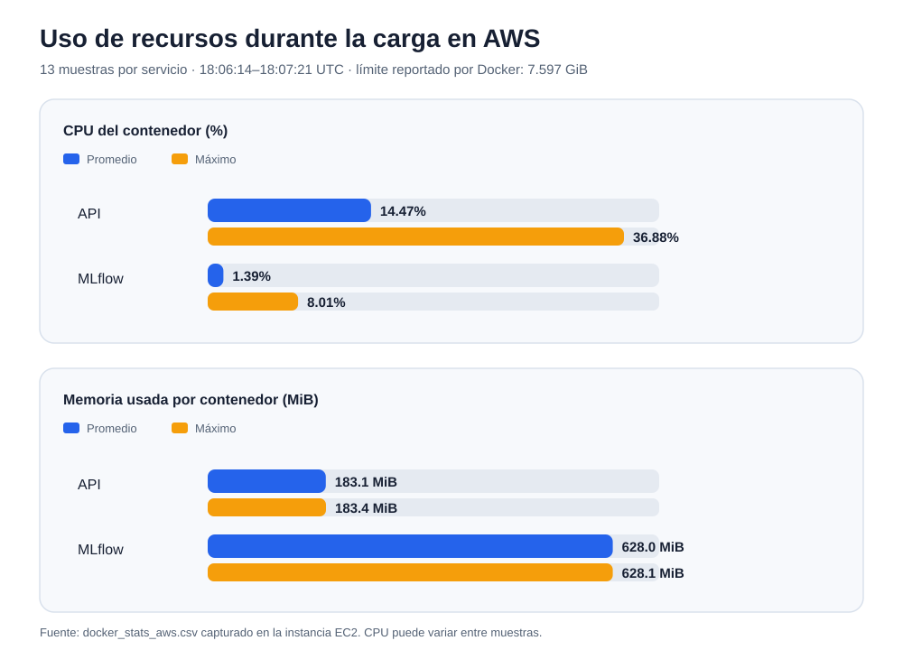

# Semana 10 — Resultados AWS y análisis FinOps

## Alcance del despliegue

La prueba se ejecutó el 22 de noviembre de 2026 en AWS, región US East (Ohio), **us-east-2**. CloudFormation aprovisionó una instancia EC2 **m7i-flex.large** (2 vCPU y 8 GiB de memoria), volumen cifrado EBS gp3 de 30 GiB y bucket S3 privado. Docker Compose levantó la API de predicción y MLflow; el acceso administrativo se realizó con Systems Manager Session Manager y el grupo de seguridad no abrió puertos de entrada. Locust se ejecutó como contenedor en la misma instancia.

## Escenario y resultados de Locust

- Locust 2.47.0; 20 usuarios, llegada de 5 usuarios por segundo y duración configurada de 1 minuto.
- Cada usuario envió solicitudes POST a /predict con datos válidos del contrato P1 y esperó entre 0.2 y 0.8 segundos.
- Resultado final: **2,305 solicitudes y cero fallos**.

| Métrica AWS | Resultado |
|---|---:|
| Solicitudes completadas | 2,305 |
| Fallos / tasa de error | 0 / 0.00 % |
| Throughput | 38.52 solicitudes/s |
| Latencia promedio | 6 ms |
| Mediana | 5 ms |
| p95 | 11 ms |
| p99 | 17 ms |
| Máximo | 29 ms |

La distribución de latencia se mantuvo baja durante esta ejecución: el 95 % de las respuestas quedó en 11 ms o menos y no hubo errores reportados. El máximo de 29 ms fue cercano a la cola alta de la distribución. Estos resultados describen una sola prueba breve; no demuestran por sí solos la capacidad máxima sostenida ni la disponibilidad del servicio a largo plazo. Como Locust y la API compartieron EC2, el throughput también depende de los recursos que consumió el generador.

## CPU y memoria observadas en AWS

El script tomó 13 muestras por servicio entre 18:06:14 y 18:07:21 UTC. El límite de memoria mostrado por Docker fue 7.597 GiB.

| Servicio | CPU promedio | CPU máxima | Memoria promedio | Memoria máxima |
|---|---:|---:|---:|---:|
| API | 14.47 % | 36.88 % | 183.1 MiB | 183.4 MiB |
| MLflow | 1.39 % | 8.01 % | 628.0 MiB | 628.1 MiB |

API fue el contenedor con mayor uso de CPU; MLflow mantuvo el uso bajo y estable. En estas muestras, API y MLflow usaron alrededor de 812 MiB de memoria combinada, cerca del 10.7 % del límite que Docker reportó. Esto sugiere margen para evaluar una instancia menor, pero debe confirmarse con pruebas repetidas y con Locust en un host separado si se busca medir la capacidad de la API sin el generador.

## Estimación FinOps

La estimación usa tarifas de referencia bajo demanda para us-east-2, sin descuentos, impuestos ni créditos aplicados a la cuenta:

| Componente | Precio de referencia |
|---|---:|
| EC2 m7i-flex.large | USD $0.0958/h |
| IPv4 pública en uso | USD $0.0050/h |
| EBS gp3 de 30 GiB | USD $2.40/mes (USD $0.00329/h prorrateado) |
| **Total base estimado** | **USD $0.10409/h** |

Con el tipo de cambio de **MXN $19.027 por USD** publicado el 20 de noviembre de 2026, el costo base estimado es aproximadamente **MXN $47.53 por 24 horas** o **MXN $1,445.75 por 730 horas**. Con un margen presupuestario de 16 %, conviene presupuestar cerca de MXN $55.14 por día o MXN $1,677.07 por mes continuo. La tarifa mensual prorratea los 30 GiB de EBS y considera una instancia activa todo el tiempo.

A 38.52 solicitudes/s, el throughput medido equivale a 138,672 inferencias por hora. Dividir el costo base horario entre ese volumen produce un costo estimado de **USD $0.000000751 por inferencia**, equivalente a **USD $0.75 o MXN $14.28 por millón de inferencias**. Esta cifra supone que el throughput observado se mantiene durante toda la hora y distribuye los costos fijos de la instancia, IPv4 y disco entre esas inferencias.

El cálculo no es el total facturado del ejercicio: el tiempo real que la instancia permaneció aprovisionada, S3, transferencia de datos e impuestos pueden modificar la cuenta. La factura y Cost Explorer son la fuente para conocer el importe efectivamente cobrado.

### Optimizaciones propuestas

1. Eliminar el stack de CloudFormation al terminar la práctica, después de descargar los artefactos, para detener EC2 y borrar el volumen asociado.
2. Repetir la prueba en AWS con Locust en otro host y con varios niveles de concurrencia; comparar throughput, percentiles y errores antes de cambiar el tamaño de EC2.
3. Si las repeticiones confirman margen de CPU y memoria, probar una instancia menor y comparar su costo por millón de inferencias con la misma carga.
4. Mantener la expiración corta de los objetos S3 y revisar el volumen de reportes almacenado.
5. Para tráfico variable de producción, evaluar escalamiento de réplicas y horarios de apagado; evitar pagar una instancia continua cuando no hay solicitudes.

## Evidencias AWS

- [Resumen gráfico HTML](locust_report.html)
- [Resumen final CSV de Locust](locust_stats_stats.csv)
- [Métricas de carga usadas para las gráficas](locust_aws_summary.csv)
- [Muestras de CPU/memoria tomadas en EC2](docker_stats_aws.csv)
- [Gráfica de desempeño](figures/aws_loadtest_performance.svg)
- [Gráfica de recursos](figures/aws_resource_usage.svg)
- El reporte nativo de Locust y las series originales también se cargaron en el prefijo privado s3://semana10-microservicios-cicd-finops-artifactbucket-rdwpcgmqktm0/reports/semana10/.

**Referencias de precios:** [AWS EC2 On-Demand](https://aws.amazon.com/ec2/pricing/on-demand/), [precio de IPv4 pública](https://aws.amazon.com/vpc/pricing/), [precio de EBS gp3](https://aws.amazon.com/ebs/pricing/) y [tipo de cambio DOF/Banxico](https://www.banxico.org.mx/tipcamb/tipCamMIAction.do). Los precios pueden cambiar; la consola de AWS Pricing Calculator permite recalcularlos antes de una nueva ejecución.
